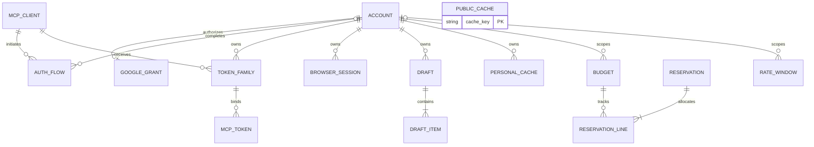

# Shared data model

Issue #41 defines the logical records behind the storage port. Services supply the verified owner and request a transaction; the storage adapter enforces ownership, uniqueness and atomic updates in PostgreSQL. Independent server instances see the same state. The domain layer can calculate a cost or a state transition without opening a database connection. See the [SRS](../srs.md), [layer boundaries](../adr/0003-layered-architecture.md) and [decision note](../../brain/areas/decision-shared-data-model.md).

## Relationships

## Reading the field catalogue

PK means primary key, FK means foreign key and UQ means unique. Each PK and UQ has an index. Index owner FKs for scoped reads and disconnect, and deadlines for scheduled deletion. All deadlines are UTC instants except the quota day, which uses the configured project time zone. Reject expired records on access even between cleanup runs.

**Field protection (SC-1, SC-2, PV-6).** Fields marked **sealed** use authenticated encryption with a fresh nonce, a key version and associated data identifying the record and field. Keep keys in the platform secret store. Rotate by writing with the new version, re-encrypting older rows in bounded batches and verifying completion before retiring old keys, accounting for backup recovery. **Digest** means a one-way lookup value. Use a keyed digest for guessable identifiers such as the Google subject, address and personal cache key. Generate bearer credentials with at least 256 random bits and persist only a digest. All other listed fields are structural metadata visible to the database (opaque identifiers, relationships, validated public client metadata, timestamps, workflow states and counters). Apply the row's retention rule to every field and index entry. Never copy tokens, subject strings, draft contents or personal cache keys into logs.

### Accounts and credentials

| Record and requirement | Fields, keys and indexes | Retention |
|---|---|---|
| ACCOUNT · AC-7, AC-9, AC-10 | Random account ID (PK), verified Google subject digest (UQ). Compute the digest only after validating the Google ID token. The internal ID scopes all personal queries. | Until disconnect. Omit email, display name and raw ID token. |
| GOOGLE_GRANT · AC-8, AC-11, SC-2 | Account ID (PK/FK), **sealed** access token, refresh token and granted scopes; access and refresh expiry when supplied; version for concurrent refresh. | Drop expired access material independently. Remove invalid refresh material on expiry or revocation and require reauthorization. Delete on disconnect. |
| MCP_CLIENT · AC-6, IF-7 | Validated client ID (PK), registration method, exact validated redirect URI set, metadata expiry for cached client documents. Store only the registration fields required by the supported public-client flows. | Expire cached metadata at its freshness deadline; keep dynamic registration until deregistration or configured inactivity expiry. |
| AUTH_FLOW · AC-6, AC-7, SC-7 | Random flow ID (PK), client FK, optional account FK set after sign-in, state digest (UQ), nonce and browser-binding digests, **sealed** Google PKCE verifier and pending request (exact redirect, resource, scope, MCP S256 challenge); short expiry; single-use MCP code digest (UQ when issued). | Clear Google callback secrets when consumed. Delete the remaining row on code exchange, failure, expiry or owner disconnect. |
| TOKEN_FAMILY · AC-5, AC-6, SC-1 | Random family ID (PK), client and account FKs, resource audience, allowed scope, family expiry. | Until family expiry or revocation; delete dependent tokens together. |
| MCP_TOKEN · AC-6, SC-1 | Token digest (PK), family FK, kind (access or refresh), expiry, consumed flag for refresh replay detection. Validate the family, audience, scope, kind and deadline at lookup. | Access tokens expire within one hour. Keep a spent refresh digest as a replay marker until family expiry or revocation. Retain no usable token value. |
| BROWSER_SESSION · SC-3, SC-8, FR-5.13 | Session-cookie digest (PK), account FK, CSRF digest, expiry. Browser and MCP lookups use separate tables. | Delete on logout, expiry or disconnect. |

### Playlist drafts and caches

| Record and requirement | Fields, keys and indexes | Retention |
|---|---|---|
| DRAFT · FR-5.9–FR-5.19, FR-7 | Random draft ID (PK), account FK, created and expiry times, state, write version, in-flight step (create or item position); **sealed** topic, constraints, estimated cost, resulting private playlist ID, readback and analysis. Index (account, draft ID). | Pending approval expires after 30 minutes. Purge every draft and its items within 24 hours after its expiry, sooner on disconnect. |
| DRAFT_ITEM · FR-5.9, FR-5.15–FR-5.19 | (Draft FK, position) PK; **sealed** video ID and display/validation snapshot (title, channel, duration, language and selection metadata required for analysis); progress (pending, skipped, inserted), **sealed** skip reason when applicable. | Same as parent. Freeze the ordered IDs, snapshot and constraints at creation. Only execution progress changes. |
| PUBLIC_CACHE · AC-2, QM-5 | Canonical cache key (PK), kind, public metadata or public search result, expiry. Admit only reusable public lookups; exclude personal queries and account context. | Default 24 hours for metadata, six hours for search results. |
| PERSONAL_CACHE · QM-5, PV-2, PF-12 | (Account FK, keyed lookup digest) PK, **sealed** bounded response, expiry. Derive the digest over owner, operation and normalized arguments. | At most one hour, or disconnect if earlier. |

For PF-12, serialize draft and personal-cache admissions on the account row. Count stored draft headers, items and cache payloads including encryption overhead. Evict expired entries first, then evict expendable cache entries or refuse an admission that would exceed 5 MB. Preserve unexpired drafts.

### Quota and rate windows

| Record and requirement | Fields, keys and indexes | Retention |
|---|---|---|
| BUDGET · QM-1–QM-4, QM-7, QM-9 | Budget ID (PK), project, project day, layer (global, public, account), account FK only for account layer; per pool (units and search calls) hold limit, outstanding reservation, charged usage and exhaustion flag. Unique (project, day, layer) for shared rows and (project, day, account) for account rows. | Reset by selecting the new day. Retire old rows after outstanding calls are settled or conservatively charged. Delete owner-specific rows on disconnect. |
| RESERVATION · QM-2, QM-4 | Unique workflow attempt ID (PK), settlement state, deadline. A retry of the same attempt reads its existing outcome. | Keep through settlement and the retry window for that day. Discard with the retired ledger. |
| RESERVATION_LINE · QM-1–QM-4 | (Reservation FK, budget FK) PK, estimated units/search calls and charged units/search calls; index budget FK. One line for each applicable layer. | Same as reservation, subject to owner deletion. |
| RATE_WINDOW · QM-8 | (Minute, tier, caller key) PK, count. For signed-in calls the key is the account FK; for public calls use a short-lived keyed address digest derived from the trusted client address. Apply a check constraint for exactly one key type. | Discard at window end and delete account rows on disconnect. No address history. |

## Transaction boundaries

1. **Quota reservation and settlement.** Calculate the worst-case pair after cache hits, including pagination. Lock the project-day global row first, then the public or verified-account row. Initialize missing rows under their unique keys. For each pool and layer require `charged + outstanding + estimate <= limit` and an available pool for any nonzero cost. Defaults are 10,000 units and 100 searches globally, 30% of each for public callers, and 3,000 units and 10 searches per account. Commit the attempt, lines and outstanding increments together before dispatch. A failing check rolls back all layers. Settle once under the same locks by removing the estimate from outstanding and adding actual charges, including failed calls. Charge the uncertain portion conservatively after a worker crash; never release a possibly spent reservation solely because its lease expired. Mark an exhausted upstream pool on the global day row until reset. At a day boundary reserve remaining calls against the new day's rows before dispatch. See [ADR 0001](../adr/0001-enforce-quota-budget-before-api-calls.md).
2. **Draft confirmation.** Verify the browser session, same origin and CSRF token, then conditionally claim the owner's unexpired pending draft by state and version. Only the winning request may proceed. Revalidate the snapshot and minimum item count before the first write. Persist each external write intent before dispatch and its result before advancing. A known partial result can resume on fresh browser confirmation from the first remaining item. A timeout or abandoned in-flight intent makes the result uncertain and blocks automatic retry. A local transaction cannot roll back a YouTube write. See [ADR 0002](../adr/0002-browser-only-playlist-confirmation.md).
3. **Sign-in and rotation.** Atomically consume a live matching callback state with its browser binding. Exchange a live MCP code only after checking client, redirect, audience and PKCE, deleting it and issuing its family in one transaction. For refresh, lock the family and recheck the presented digest. Consume it and insert the new pair in one commit. Reuse of a consumed digest revokes the whole family, including outstanding access tokens. Coordinate Google refresh separately by account so two workers cannot overwrite a newly rotated grant.
4. **Disconnect and cleanup.** Serialize personal writes and disconnect against the account. Disable access before cleanup, attempt upstream grant revocation while the credential is available, and complete local deletion even when Google is unreachable. Cascade owner records, including pending flows, token families and draft items. Settle outstanding reservations conservatively against shared counters before removing personal ledger links. Preserve only anonymous project totals. The privacy notice must disclose database-provider backup retention and structural metadata visibility (PV-3, PV-6).
