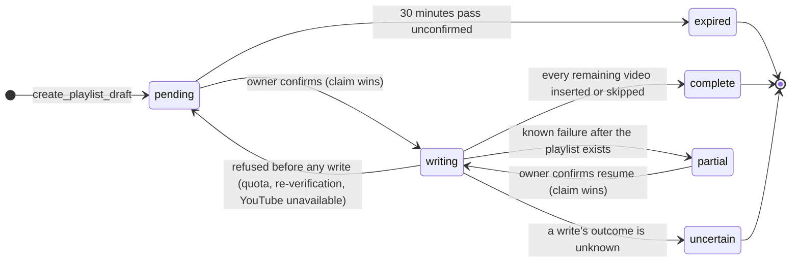
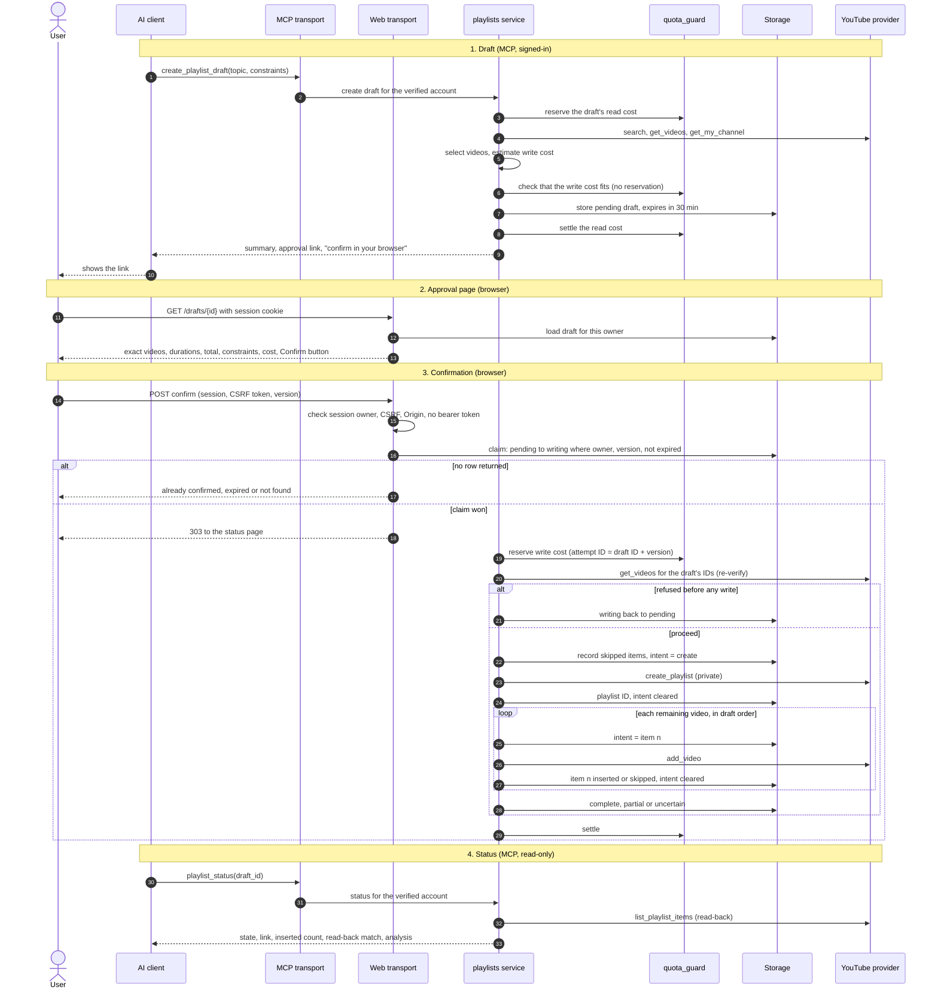

# Playlist drafts and browser confirmation

- **Status:** Accepted
- **Issue:** #45
- **Decision note:** [`brain/areas/decision-playlist-confirmation-flow.md`](../../brain/areas/decision-playlist-confirmation-flow.md)
- **Requirements:** FR-5.9 to FR-5.19, SC-3, SC-4, SC-8, SC-9, QM-2, QM-4, AC-10, PF-5

[ADR 0002](../adr/0002-browser-only-playlist-confirmation.md) decided that a playlist is written only after its owner confirms in their own browser. This document is the run-time design behind that: the draft's states, what is persisted before each YouTube write, how a draft is re-verified, how duplicate confirmations, resumption and uncertain outcomes are handled, and where quota is checked. The selection algorithm (FR-5.1 to FR-5.8) and the implementation are out of scope.

## 1. What this design builds on

| Existing piece | Where | Used for |
|---|---|---|
| DRAFT and DRAFT_ITEM records: state, write version, in-flight step, sealed snapshot, per-item progress | [data-model.md](data-model.md) | Everything this design persists |
| Transaction boundary 2, "Draft confirmation" | [data-model.md](data-model.md) | The single-winner claim; intent before each write |
| "Confirm and resume drafts" row | [ADR 0006](../adr/0006-storage.md) | Conditional update with a returned-row check; network calls outside transactions |
| `PlaylistWriter` (`create_playlist`, `add_video`), `AccountReader.list_playlist_items`, `Transient(outcome_known)`, `WriteRejected` | [provider-interface.md](provider-interface.md) §5.2, §6, §8 | The only writes, the read-back, and how failures are told apart |
| `draft_expired`, `draft_not_confirmable`, `not_enough_videos`, `playlist_write_rejected`, `outcome_uncertain`, `session_required`, `request_rejected` | [errors.md](errors.md) §3.3, §3.4 | What the user sees |
| Plan, estimate, reserve, meter, settle | [quota-and-caching.md](quota-and-caching.md) §4 | Quota at draft time and at confirmation |

## 2. Where each step runs

| Step | Entry point | Credential | Tier |
|---|---|---|---|
| Create a draft | MCP tool `create_playlist_draft` | MCP access token | Signed-in |
| View the draft | Browser page `GET /drafts/{draft_id}` | Browser session cookie | Owner only |
| Confirm or resume | Browser form `POST /drafts/{draft_id}/confirm` | Browser session cookie + CSRF token | Owner only |
| Follow progress | Browser page `GET /drafts/{draft_id}/status`; MCP tool `playlist_status` | Session cookie; MCP access token | Owner only; Signed-in, read-only |

The two credential types never cross over (SC-3, FR-5.14):

- **Browser routes refuse MCP credentials.** A request to `/drafts/…` carrying an `Authorization` header is refused with `request_rejected`, whatever the token. The routes read only the session cookie.
- **The MCP endpoint refuses browser sessions.** `/mcp/` ignores cookies and authenticates only bearer tokens, so a session cookie never authenticates an MCP request.
- **No MCP capability changes a draft.** The MCP tool list has `create_playlist_draft` (makes a new pending draft) and `playlist_status` (read-only). There is no tool, resource or prompt that confirms, resumes or edits a draft, and the AC-1 allow-list is checked for this in tests.

Route paths are proposals for the web transport design to confirm.

## 3. States



| State | Meaning | Confirmable? | Ends |
|---|---|---|---|
| `pending` | Drafted, not yet confirmed. Nothing written. | Yes, until `expires_at` | Becomes `expired` 30 minutes after creation (FR-5.10) |
| `writing` | One request holds the claim and is writing to YouTube | No | When the writer finishes, or by recovery (section 7) |
| `complete` | The playlist exists and every video was inserted or skipped with a reason | No | Kept for status until purged |
| `partial` | The playlist exists, some videos are not inserted yet, and the cause is **known** | Resume only, with a new confirmation (FR-5.17) | Until purged |
| `uncertain` | A write may or may not have happened | No; never retried (FR-5.18) | Until purged |
| `expired` | Never confirmed in time | No | Until purged |

**Expiry is checked on access**, not only by a cleanup job. A pending draft past `expires_at` is treated as `expired` everywhere, even before any job has updated the row (data model: "Reject expired records on access").

**Retention.** The data model purges every draft and its items within 24 hours after its expiry. A `partial` draft can therefore be resumed until it is purged, and `playlist_status` answers until then. After that, the draft is unknown and the playlist simply lives in the user's YouTube account.

**Immutable content (FR-5.9).** The ordered video IDs, the metadata snapshot, the constraints and the estimated cost are fixed when the draft is created. Only `state`, `version`, `in_flight`, the resulting playlist ID, the per-item progress (`pending`, `skipped`, `inserted`) and the read-back change afterwards.

## 4. Sequence



## 5. Step by step

### 5.1 Creating the draft (`create_playlist_draft`)

1. The caller must be signed in. A public caller gets HTTP 401 (AC-4).
2. `get_my_channel` runs first. An account without an active channel gets `channel_required` now (AC-12), not at confirmation.
3. Selection (FR-5.1 to FR-5.8, out of scope here) produces an ordered list. `constraints_unsatisfiable` and `not_enough_videos` are returned at this point if needed (FR-5.6), and nothing is stored.
4. **Quota at draft time (ADR 0001).** The draft's own reads are reserved and settled like any workflow. The confirmation's cost is estimated with the domain's `estimate`:

   | Planned call | Requests |
   |---|---|
   | `videos.list` re-verification | `requests_needed(n)`, 1 for up to 50 videos |
   | `playlists.insert` | 1 |
   | `playlistItems.insert` | n |

   For *n* = 20 that is 1 + 50 + 1,000 = **1,051 units**. The estimate is checked with `check_budgets` against the account's and the global remaining budget, **without reserving**. If it does not fit, the draft is refused with `quota_budget_exceeded`. A draft that could not be confirmed today is not worth creating. If it fits, the estimate is stored, sealed, in the draft and shown on the approval page.
5. The draft is stored in one transaction, under the account lock so the 5 MB cap holds (PF-12): state `pending`, `version` 1, `expires_at` = now + 30 minutes, the ordered IDs and snapshot, the constraints, the estimate and the owner.
6. The response contains the summary and constraint check (FR-5.8), the approval link `/drafts/{draft_id}`, and a statement that confirmation happens in the user's own browser (FR-5.11).

The draft ID is a random identifier. It is not a secret: knowing it gives nothing, because every route checks the owner.

### 5.2 The approval page (`GET /drafts/{draft_id}`)

- **No session:** redirect to sign-in, then back to this page (`session_required`).
- **The session's account does not own the draft, or the draft does not exist:** `not_found`, the same response in both cases (AC-10).
- **Pending and unexpired:** the page shows exactly what will be written: the ordered videos with title, channel and duration, the total runtime, the constraints, the estimated quota cost, and the statement that the playlist will be private. It has one form with a Confirm button, carrying the CSRF token and the draft's current `version` as hidden fields.
- **Expired:** `draft_expired`, no form.
- **Any other state:** the status page instead, with a Resume form only for `partial`.

The page is a plain GET with no side effects. Opening the link, or a link preview, can never confirm anything.

Every piece of text from YouTube on the page is HTML-escaped (SC-4) and rendered as text, never as markup or links. The page sends the security headers of SC-9, including `frame-ancestors 'none'`, so it cannot be framed by another site and clicked through (clickjacking).

### 5.3 Confirming (`POST /drafts/{draft_id}/confirm`)

**Checks, before touching the draft** (FR-5.13, SC-8):

1. The request has a valid browser session, and the session's account owns the draft. Otherwise `session_required` or `not_found`.
2. The CSRF token in the form matches the one bound to the session.
3. `Origin` equals the configured public origin, or, if `Origin` is absent, `Sec-Fetch-Site` is `same-origin`. A request with neither is refused.
4. There is no `Authorization` header (FR-5.14).

A failure of checks 2 to 4 gives `request_rejected`, without saying which check failed.

**The claim (FR-5.16).** One conditional update, as in ADR 0006:

```
UPDATE draft SET state = 'writing', version = version + 1, lease_until = now + lease
WHERE id = :draft AND account_id = :owner AND state = 'pending'
  AND version = :version_from_form AND expires_at > now
RETURNING version
```

(Resume uses `state = 'partial'` and no expiry condition.) Only a request that gets a row back may continue. Every other request learns the current state and gets `draft_expired`, `draft_not_confirmable` or `not_found`. So:

- **Double clicks and replays** of the same form: the second request carries the old version, matches no row and changes nothing.
- **Two tabs or two devices** confirming at once: the database lets exactly one update win (SL-2).
- **A lost response** after a successful claim: the user reloads, the page shows `writing` or a later state, and no second playlist is created.

The winning request redirects the browser to the status page right away (303) and continues the write in the background on the same instance. The write survives the browser closing, and the status page refreshes itself until the draft leaves `writing`. PF-5 allows up to 90 seconds for 50 videos, which is too long for a request the user waits on.

**Quota at confirmation (ADR 0001, QM-2).** Before any write, `quota_guard` estimates again and **reserves**. The estimate is recomputed rather than read from the draft, because the cost table may have changed. The attempt ID is the draft ID plus the claimed version, so a retried reservation for the same claim reserves only once. Budgets may have changed since the draft was made. If the reservation does not fit, the draft goes back to `pending` (section 6), and the user sees `quota_budget_exceeded` or `quota_exceeded` on the status page and can try again until the draft expires.

**Re-verification (FR-5.9).** One `get_videos` call (with `requests_needed(n)` batches) through the public reader, for the draft's IDs, uncached so it sees YouTube's current state. Each video is checked against the stored constraints with the same domain rules the selection used: still available and public, not live or upcoming, duration known and within `min_seconds` and `max_seconds`, and the requested language if one was given. The draft's content is not changed: a video that fails is marked `skipped` with a reason, and the rest keep their order.

- If a minimum number of videos was requested (`count_mode` `exactly` or `at_least`) and fewer remain, the draft goes back to `pending` and the user gets `not_enough_videos`. Nothing is written.
- If `total_seconds` is exceeded, it can only be because a remaining video's duration grew. That video is skipped, and the count rule above applies again.
- If YouTube is unavailable, the draft goes back to `pending` with `upstream_unavailable`.

**Writing (FR-5.15, FR-5.16).** Each external write follows the same pattern: **commit the intent, make the call, commit the result**:

1. Commit the skipped items and `in_flight = create`.
2. `create_playlist(NewPlaylist(title from the topic, description stating it was generated by youtube-sieve))`. The writer always creates it private.
3. Commit the playlist ID and `in_flight = none`.
4. For each item still `pending`, in draft order:
   1. Commit `in_flight = item n`.
   2. `add_video(playlist_id, video_id)`.
   3. Commit item *n* as `inserted` (or `skipped` with its reason) and `in_flight = none`.
5. Commit the final state (section 6) and settle the quota reservation.

Every update in steps 1 to 5 is also conditional on `version` and `state = 'writing'`, so a request that lost the claim, or a recovery that already took over (section 7), can never write progress.

### 5.4 Resuming a partial draft (FR-5.17)

The status page of a `partial` draft shows what was inserted, what is left and why it stopped. It also has a Resume form with the same CSRF, origin and session checks as confirmation, plus a new deliberate click. The claim is `partial` → `writing`. Then:

- The quota estimate covers only what is left: re-verification of the remaining items, and 50 units for each of them. A playlist already exists, so there is no `create_playlist`.
- Re-verification runs again for the remaining items.
- Writing continues from the first item still `pending`. Items already `inserted` are never sent again, so only the remaining videos are inserted.

If YouTube answers `videoAlreadyInPlaylist` for an item, the item is counted as inserted, because the result is the same.

Each resume is a new workflow with its own reservation, so a resume after midnight Pacific Time is charged to the new quota day.

### 5.5 Following progress

**`playlist_status(draft_id)`** is read-only and Signed-in (FR-5.19). For the caller's own draft it returns:

- the state;
- for `writing`, the progress so far;
- the playlist link and ID once created;
- the number of videos inserted and skipped, with reasons;
- for `complete` and `partial`, the read-back: `AccountReader.list_playlist_items` on the created playlist, and whether its video IDs and order match the inserted items;
- once `complete`, the playlist analysis (FR-7).

A draft that is unknown or belongs to someone else returns `not_found`, which reveals nothing (AC-10). The read-back is a small billable workflow (1 unit per 50 items), so it goes through `quota_guard` like any other. It is never cached, because it must show YouTube's real state.

**The status page** shows the same in the browser and refreshes itself while the state is `writing`.

## 6. Outcomes of each step

Every row says what is committed **before** the next external write, which is the first acceptance criterion.

| Event | Draft afterwards | Committed before the next YouTube write | What the user sees |
|---|---|---|---|
| Claim wins | `writing`, version + 1, lease set | The claim itself | Status page: "creating your playlist" |
| Reservation refused | `pending` again, version + 1 | Release of the claim | `quota_budget_exceeded` or `quota_exceeded`; may confirm again before expiry |
| Re-verification leaves too few videos | `pending` again | Release of the claim; skipped marks are **not** kept | `not_enough_videos` |
| YouTube unavailable during re-verification | `pending` again | Release of the claim | `upstream_unavailable`; may try again |
| Re-verification passes | `writing` | Skipped items, `in_flight = create` | — |
| `create_playlist` succeeds | `writing` | Playlist ID, `in_flight = none` | — |
| `create_playlist` fails, known: `Transient(outcome_known=True)`, `QuotaExhausted`, `AuthRequired`, `ChannelRequired`, `WriteRejected(PLAYLIST_LIMIT)` | `pending` again; nothing was created | Release of the claim | The matching error, e.g. `playlist_limit_reached`, `reauthorization_required`; may try again before expiry |
| `create_playlist` outcome unknown: `Transient(outcome_known=False)` | `uncertain` | Final state | `outcome_uncertain`: check your YouTube account |
| Before each `add_video` | `writing` | `in_flight = item n` | — |
| `add_video` succeeds, or `WriteRejected(DUPLICATE_ITEM)` | `writing` | Item *n* `inserted`, `in_flight = none` | — |
| `add_video` raises `NotFound` for the video | `writing` | Item *n* `skipped` with reason, `in_flight = none` | Listed as skipped |
| `add_video` fails, known: `QuotaExhausted`, `Transient(outcome_known=True)`, `AuthRequired`, `WriteRejected(PLAYLIST_FULL or FORBIDDEN)`, `QuotaReservationExceeded` | `partial` | Final state, `in_flight = none` | `playlist_write_rejected` or the matching error; may resume (section 5.4) |
| `add_video` outcome unknown | `uncertain` | Final state | `outcome_uncertain` |
| Last item done | `complete` | Final state | Link to the playlist, and the read-back in `playlist_status` |

Two rules follow from the table:

- **A known failure before the playlist exists is not a partial result.** Nothing was written, so the draft returns to `pending` and the original confirmation flow applies. That keeps `partial` meaning exactly what FR-5.17 says: some videos were inserted into a playlist that exists.
- **An unknown outcome is final.** The System never retries a write automatically (IF-11, FR-5.18), because a retry could create a second playlist or a duplicate item. The user is told to check their YouTube account. No Resume form is offered for `uncertain`.

A `QuotaReservationExceeded` from the meter means the estimate was wrong. No request was sent, so the outcome is known; it is treated as `partial` and logged as a bug.

## 7. Recovery when a writer dies

The background writer can stop without finishing, for example if the instance is restarted. The lease lets any instance notice this: a draft in `writing` whose `lease_until` has passed is **abandoned**. The writer renews the lease after each committed step, so a slow but live writer is never taken over.

This needs one field that [data-model.md](data-model.md) does not list yet: a `lease_until` timestamp on DRAFT. It is structural metadata (not sealed), cleared when the draft leaves `writing`. The data model should add it when the storage schema is written.

Recovery runs when the draft is next accessed (status page, approval page or `playlist_status`) and in the cleanup job. It takes over with a conditional update on the same `version`, so only one recovery can win, and the old writer's late commits fail their version check. The result depends only on what was committed:

| Committed state at the abandoned point | Recovered state | Why |
|---|---|---|
| `in_flight = create` | `uncertain` | The playlist may have been created |
| `in_flight = item n` | `uncertain` | Item *n* may have been inserted |
| `in_flight = none`, playlist ID set, items still `pending` | `partial` | Every write is accounted for, and the next one was never started |
| `in_flight = none`, no playlist ID | `pending` (or `expired` if past `expires_at`) | Nothing was written |

Recovery never makes a YouTube call. Its reservation is settled conservatively, charged in full ([quota-and-caching.md](quota-and-caching.md) §4, step 5).

## 8. Why an MCP request cannot confirm or resume a draft

The second acceptance criterion holds at three independent levels:

1. **No capability.** The MCP surface has no operation that changes a draft's state. `create_playlist_draft` can only insert a new `pending` draft, and `playlist_status` only reads. The allow-list test fails if a new MCP operation can reach the claim.
2. **No credential.** Confirmation and resume routes accept only a browser session cookie, and refuse any request with an `Authorization` header. The MCP endpoint accepts only bearer tokens and ignores cookies (SC-3). Neither credential can be turned into the other.
3. **No forged browser request.** The CSRF token, the same-origin check, `SameSite` cookies and frame denial stop another site, or an AI-generated link, from submitting the confirmation form on the user's behalf. A plain link to the approval page is a GET with no side effects.

So text in video metadata (SC-4) can influence what the AI *says*, but not what is *written*. The approval page itself shows the user the exact draft before they click.

## 9. Settings

| Setting | Default | Requirement |
|---|---|---|
| `draft_ttl_seconds` | 1,800 | FR-5.10 |
| `draft_retention_after_expiry_seconds` | 86,400 | PV-2 |
| `max_playlist_videos` | 50 | FR-5.4 |
| `write_lease_seconds` | 30, renewed after every committed step | Section 7 |
| `status_refresh_seconds` | 3 | Status page while `writing` |

## 10. Tests this design calls for

- Two concurrent confirmations of one draft: one claim wins, exactly one `create_playlist` call is made, and the other gets `draft_not_confirmable`.
- A replayed form with an old version changes nothing.
- An expired draft is not confirmable, even before any cleanup job has run.
- A confirmation with an MCP bearer token, a missing or wrong CSRF token, a cross-origin `Origin`, or another user's session is refused, and the provider's call log stays empty.
- `playlist_status`, and every other MCP operation, leaves the draft's state unchanged.
- Re-verification with fewer than the requested minimum: `not_enough_videos`, the draft is `pending` again, and there are no writes.
- A failure on the 13th of 20 `add_video` calls: the draft is `partial` with 12 inserted; resume inserts only items 13 to 20.
- `Transient(outcome_known=False)` on `create_playlist` or `add_video`: the draft is `uncertain`, with no further calls and no Resume form.
- A writer abandoned at each `in_flight` value recovers to the state in section 7, and the abandoned reservation is charged in full.
- YouTube text containing HTML or "ignore previous instructions" is escaped on the approval page and cannot change the draft.
