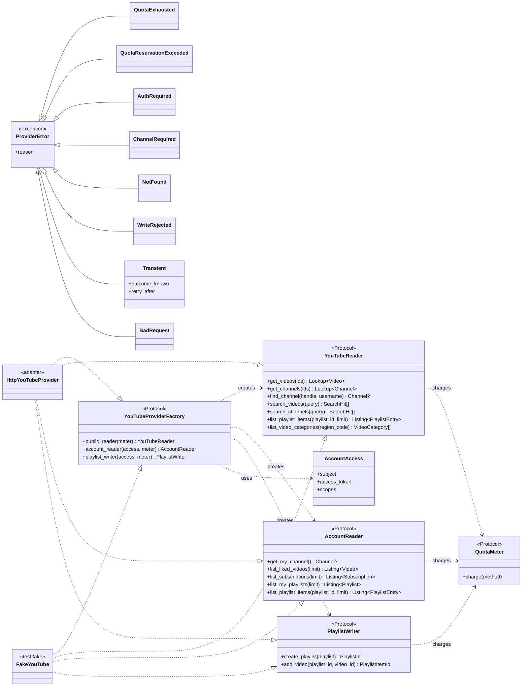

# YouTube provider interface

- **Status:** Accepted with [ADR 0005](../adr/0005-youtube-provider-interface.md)
- **Issue:** #40
- **Decision note:** [`brain/areas/decision-youtube-provider-interface.md`](../../brain/areas/decision-youtube-provider-interface.md)
- **Requirements:** SE-6, IF-10, IF-11, TQ-4, DC-1, QM-2, QM-4, QM-6, QM-9, AC-2, AC-10, AC-11, AC-12, FR-1 to FR-7

This document defines how youtube-sieve reaches YouTube: the ports the services call, the data they get back, what each call costs, how failures are reported, and how the in-memory fake behaves. It is the contract that the HTTP adapter and the fake both implement. Implementing them is out of scope here.

## 1. Where it sits

Following [ADR 0003](../adr/0003-layered-architecture.md):

| Part | Module | Layer |
|---|---|---|
| Record types (`Video`, `Channel`, …) and ID types | `youtube_sieve.domain.youtube` | Domain: plain frozen dataclasses, no I/O |
| Protocols, `QuotaMeter`, `AccountAccess`, provider errors | `youtube_sieve.ports.youtube` | Ports |
| HTTP implementation over Data API v3 | `youtube_sieve.adapters.youtube` | Adapter: the only module that imports `httpx2` for YouTube ([ADR 0004](../adr/0004-tech-stack.md)) |
| In-memory fake | `tests/fakes/youtube.py` | Test support |

Services depend only on the protocols. The composition root builds the HTTP adapter; tests pass the fake instead (IF-10).

## 2. Design rules

1. **Reads and writes are separate protocols** (IF-10). A public read path cannot reach a write method, because it never holds an object that has one.
2. **The credential is bound when the provider object is created, never passed per call.** The factory hands out a reader for the System's own API key, a reader bound to one account's access token, or a writer bound to one account's access token. A service cannot accidentally use one user's token for another user's request (AC-2, AC-10), and public reads never carry user tokens.
3. **Objects are cheap, per workflow and stateless.** A provider object lives for one tool call and holds only its credential, its quota meter and an injected HTTP client. Nothing user-specific lives at module level (SL-1).
4. **Inputs are already validated.** Methods accept typed, validated IDs and bounded counts. URL parsing and normalisation (FR-1.1, FR-2.1) happen in the domain layer before the call, because Google charges invalid requests too. Methods still check their preconditions and raise `ValueError` for a programming error, such as `max_results=0`; this never reaches the network.
5. **Bounded results, no page tokens.** Listing methods take a `limit` and page internally, stopping at `limit`. A result says whether more existed (`truncated`), so services can disclose truncation (FR-3.2). Callers never handle `pageToken`, so the worst-case number of requests is known from `limit` alone, which is what quota estimates need (QM-2).
6. **Batching is the provider's job.** ID lookups accept any number of IDs up to a named maximum and split them into requests of `MAX_RESULTS_PER_PAGE` (50) IDs (QM-6).
7. **Missing items are data, not errors.** A private, deleted or terminated video or channel is reported in `missing` in a batch result. Only a missing *target*, such as the playlist being written to, raises `NotFound`.
8. **Every request is charged before it is sent.** The provider calls `QuotaMeter.charge(method)` before each HTTP request, including retries. The meter can refuse the request (section 6).
9. **All text from YouTube is untrusted** (`AGENTS.md` rule 7, A-4). Titles, descriptions, tags, channel names and keywords are carried as data. Nothing in the provider interprets them, and they never count as consent.
10. **Official API only** (DC-1): every method maps to one Data API v3 method listed in `youtube_sieve.domain.quota.ApiMethod`.
11. **Transport limits** (IF-11): HTTPS only; each request times out after `REQUEST_TIMEOUT_SECONDS` (10, never more than 15); writes are never retried automatically.

All limits and timings in this document are named constants in `youtube_sieve.ports.youtube` (or configuration), not literals in code.

## 3. Shared types

ID types are `NewType`s over `str`. The domain layer's parsers produce them, so a value of this type is known to be well formed.

| Type | Form |
|---|---|
| `VideoId` | 11 characters from `[A-Za-z0-9_-]` |
| `ChannelId` | 24 characters starting with `UC` |
| `PlaylistId` | `[A-Za-z0-9_-]`, 2 to 64 characters |
| `PlaylistItemId` | opaque string returned by YouTube |
| `CategoryId` | decimal digits |

Records (frozen dataclasses in `youtube_sieve.domain.youtube`). Fields that YouTube may omit are optional; the adapter never invents values.

```python
class LiveStatus(StrEnum):
    NONE = "none"
    LIVE = "live"
    UPCOMING = "upcoming"


@dataclass(frozen=True)
class Video:
    id: VideoId
    title: str
    description: str
    tags: tuple[str, ...]  # empty when the uploader set none (FR-1.5)
    category_id: CategoryId | None
    channel_id: ChannelId
    channel_title: str
    published_at: datetime  # time-zone aware, UTC
    duration_seconds: int | None  # parsed with domain.durations.parse_duration; None if absent
    language: str | None  # defaultAudioLanguage, else defaultLanguage (FR-1.7)
    live: LiveStatus
    privacy_status: str  # "public", "unlisted" or "private"
    topic_categories: tuple[str, ...]  # Wikipedia URLs from topicDetails


@dataclass(frozen=True)
class Channel:
    id: ChannelId
    title: str
    description: str
    handle: str | None  # snippet.customUrl, e.g. "@example"
    keywords: tuple[str, ...]  # brandingSettings.channel.keywords, split on spaces and quotes
    topic_categories: tuple[str, ...]
    country: str | None
    language: str | None
    subscriber_count: int | None  # None when hidden (FR-2.6, FR-2.7)
    video_count: int | None
    uploads_playlist_id: PlaylistId | None


@dataclass(frozen=True)
class SearchHit:  # search.list has no duration or statistics
    id: VideoId | ChannelId
    title: str
    channel_id: ChannelId
    channel_title: str
    published_at: datetime
    live: LiveStatus


@dataclass(frozen=True)
class PlaylistEntry:
    item_id: PlaylistItemId
    video_id: VideoId
    position: int
    added_at: datetime  # date added to the playlist (FR-4.4)
    privacy_status: str | None  # deleted or private videos still appear as entries


@dataclass(frozen=True)
class Subscription:
    channel_id: ChannelId
    title: str
    subscribed_at: datetime  # snippet.publishedAt (FR-4.4)


@dataclass(frozen=True)
class Playlist:
    id: PlaylistId
    title: str
    item_count: int
    privacy_status: str
    published_at: datetime


@dataclass(frozen=True)
class VideoCategory:
    id: CategoryId
    title: str


@dataclass(frozen=True)
class Lookup[K, T]:  # result of a batched ID lookup
    found: tuple[T, ...]  # in the order the IDs were requested, duplicates removed
    missing: frozenset[K]  # requested IDs YouTube did not return


@dataclass(frozen=True)
class Listing[T]:  # result of a bounded, internally paged list
    items: tuple[T, ...]  # in the order YouTube returns them, at most `limit`
    truncated: bool  # True if YouTube had more items than `limit`


@dataclass(frozen=True)
class NewPlaylist:
    title: str  # 1 to MAX_PLAYLIST_TITLE_LENGTH (150) characters
    description: str  # at most MAX_PLAYLIST_DESCRIPTION_LENGTH (5,000) characters
    language: str | None = None
    # No privacy field: playlists are always created private (FR-5.15).
```

The account credential, in `youtube_sieve.ports.youtube`:

```python
@dataclass(frozen=True)
class AccountAccess:
    subject: str  # verified Google "sub" (AC-7)
    access_token: Secret  # repr and str print "***"; never logged
    scopes: frozenset[str]
```

Getting a valid access token, including refreshing it, is the identity adapter's job (#44). The provider only uses the token it was given.

## 4. The factory

Services receive one factory and ask it for the provider object each workflow needs.

```python
class YouTubeProviderFactory(Protocol):
    def public_reader(self, meter: QuotaMeter) -> YouTubeReader: ...
    def account_reader(self, access: AccountAccess, meter: QuotaMeter) -> AccountReader: ...
    def playlist_writer(self, access: AccountAccess, meter: QuotaMeter) -> PlaylistWriter: ...
```

| Method | Credential | Required scope | If the scope is missing |
|---|---|---|---|
| `public_reader` | System API key | none | — |
| `account_reader` | user access token | `youtube.readonly` or `youtube` | `AuthRequired(reason=INSUFFICIENT_SCOPE)`, raised before any request |
| `playlist_writer` | user access token | `youtube` (management, AC-8) | `AuthRequired(reason=INSUFFICIENT_SCOPE)`, raised before any request |

## 5. Read protocols

### 5.1 `YouTubeReader`: public data

Used by every function. Bound to the System's API key, so it only sees public data (AC-2).

```python
class YouTubeReader(Protocol):
    def get_videos(self, ids: Collection[VideoId]) -> Lookup[VideoId, Video]: ...
    def get_channels(self, ids: Collection[ChannelId]) -> Lookup[ChannelId, Channel]: ...
    def find_channel(
        self, *, handle: str | None = None, username: str | None = None
    ) -> Channel | None: ...
    def search_videos(self, query: VideoSearch) -> tuple[SearchHit, ...]: ...
    def search_channels(self, query: ChannelSearch) -> tuple[SearchHit, ...]: ...
    def list_playlist_items(
        self, playlist_id: PlaylistId, limit: int
    ) -> Listing[PlaylistEntry]: ...
    def list_video_categories(self, region_code: str) -> tuple[VideoCategory, ...]: ...
```

Search parameters:

```python
@dataclass(frozen=True)
class VideoSearch:
    q: str  # 1 to MAX_QUERY_LENGTH (200) characters
    max_results: int = 25  # 1 to 50; one request, never paged
    relevance_language: str | None = None  # ISO 639-1
    region_code: str | None = None  # ISO 3166-1 alpha-2
    published_after: datetime | None = None  # time-zone aware
    # any | short (<4 min) | medium (4–20 min) | long (>20 min)
    duration: DurationFilter = DurationFilter.ANY
    channel_id: ChannelId | None = None
    order: SearchOrder = SearchOrder.RELEVANCE  # relevance | date
    # Always sent: type=video, safeSearch=moderate.


@dataclass(frozen=True)
class ChannelSearch:
    q: str
    max_results: int = 25  # 1 to 50; one request
    region_code: str | None = None
    # Always sent: type=channel.
```

| Method | API call and parts | Parameters | Returns | Requests (worst case) | Cost |
|---|---|---|---|---|---|
| `get_videos` | `videos.list`, `id=…`, `part=snippet,contentDetails,status,topicDetails` | 0 to `MAX_LOOKUP_IDS` (500) IDs; duplicates removed | `Lookup`; private, deleted or unavailable IDs in `missing` | ⌈n / 50⌉ | 1 unit each |
| `get_channels` | `channels.list`, `id=…`, `part=snippet,statistics,brandingSettings,topicDetails,contentDetails` | 0 to 500 IDs | `Lookup`; terminated or unknown IDs in `missing` | ⌈n / 50⌉ | 1 unit each |
| `find_channel` | `channels.list`, `forHandle=` or `forUsername=`, same parts | exactly one of `handle` (with or without `@`) or `username` | the channel, or `None` | 1 | 1 unit |
| `search_videos` | `search.list`, `part=snippet`, `type=video` | `VideoSearch` | hits in YouTube's rank order; at most `max_results` | 1 | 1 search call |
| `search_channels` | `search.list`, `part=snippet`, `type=channel` | `ChannelSearch` | hits in rank order | 1 | 1 search call |
| `list_playlist_items` | `playlistItems.list`, `part=snippet,contentDetails,status`, `maxResults=50` | public playlist ID; `limit` 1 to `MAX_LISTING_ITEMS` (500) | `Listing`; used for a channel's uploads playlist (FR-1.3, FR-2.2, FR-3.4) | ⌈limit / 50⌉ | 1 unit each |
| `list_video_categories` | `videoCategories.list`, `regionCode=` | ISO 3166-1 alpha-2 | categories for that region (cacheable, QM-5) | 1 | 1 unit |

`get_videos` and `get_channels` with no IDs make no request and return an empty `Lookup`.

### 5.2 `AccountReader`: the signed-in user's own data

Bound to one user's token. It has the user-only list methods, and its `list_playlist_items` can read that user's private playlists.

```python
class AccountReader(Protocol):
    def get_my_channel(self) -> Channel | None: ...
    def list_liked_videos(self, limit: int) -> Listing[Video]: ...
    def list_subscriptions(self, limit: int) -> Listing[Subscription]: ...
    def list_my_playlists(self, limit: int) -> Listing[Playlist]: ...
    def list_playlist_items(
        self, playlist_id: PlaylistId, limit: int
    ) -> Listing[PlaylistEntry]: ...
```

| Method | API call | Parameters | Returns | Requests (worst case) | Cost |
|---|---|---|---|---|---|
| `get_my_channel` | `channels.list`, `mine=true` | — | the user's channel, or `None` if the account has none (checked before drafting; AC-12) | 1 | 1 unit |
| `list_liked_videos` | `videos.list`, `myRating=like`, same parts as `get_videos` | `limit` 1 to 500 (Google caps this list at 1,000) | full `Video` records, so no second lookup is needed. **No date liked** is available (FR-4.4) | ⌈limit / 50⌉ | 1 unit each |
| `list_subscriptions` | `subscriptions.list`, `mine=true`, `part=snippet` | `limit` 1 to 500 | `Listing[Subscription]` with the subscription date | ⌈limit / 50⌉ | 1 unit each |
| `list_my_playlists` | `playlists.list`, `mine=true`, `part=snippet,status,contentDetails` | `limit` 1 to 500 | `Listing[Playlist]` | ⌈limit / 50⌉ | 1 unit each |
| `list_playlist_items` | `playlistItems.list` | any playlist the user can read; `limit` 1 to 500 | `Listing[PlaylistEntry]`; used for FR-3 sampling, the FR-5.17 resume check and the FR-5.19 read-back | ⌈limit / 50⌉ | 1 unit each |

## 6. Write protocol: `PlaylistWriter`

The only methods that change a user's account. Called only by the playlists service after a browser confirmation (ADR 0002, FR-5.12 to FR-5.14).

```python
class PlaylistWriter(Protocol):
    def create_playlist(self, playlist: NewPlaylist) -> PlaylistId: ...
    def add_video(self, playlist_id: PlaylistId, video_id: VideoId) -> PlaylistItemId: ...
```

| Method | API call | Parameters | Returns | Requests | Cost |
|---|---|---|---|---|---|
| `create_playlist` | `playlists.insert`, `part=snippet,status`, `privacyStatus=private` always | `NewPlaylist` | the new playlist's ID | 1 | 50 units |
| `add_video` | `playlistItems.insert`, `part=snippet`, no `position` (it fails with `manualSortRequired` on playlists not sorted manually) | target playlist and one video | the new item's ID | 1 | 50 units |

A playlist of *n* videos is 1 + *n* write requests and 50 + 50·*n* units. There is no bulk insert and no transaction. The playlists service persists progress before each call (FR-5.16), and resumes by reading back the playlist and adding only what is missing (FR-5.17). The provider does not track progress itself.

Writes are **never retried** by the provider (IF-11). If the request may have reached Google but no answer came back, the provider raises `Transient(outcome_known=False)`, and the service marks the draft *uncertain* (FR-5.18).

## 7. Quota

The provider never decides budgets. That is the quota guard's job (ADR 0001, #46). It only reports each request through a meter, which the guard supplies for the workflow:

```python
class QuotaMeter(Protocol):
    def charge(self, method: ApiMethod) -> None:
        """Called before each HTTP request. Raises QuotaReservationExceeded if the request
        would go beyond what this workflow reserved, in which case the request is not sent."""
```

How this fits ADR 0001:

1. The service builds a plan from the worst-case request counts in sections 5 and 6, for example `PlannedCall(ApiMethod.VIDEOS_LIST, requests_needed(len(ids)))`, and estimates it with `domain.quota.estimate`.
2. The guard checks and reserves the estimate (QM-2, QM-4). If it does not fit, the workflow is rejected and the provider is never called (TQ-6).
3. During the workflow, every request is charged. The meter's running total is the *actual* cost used by `domain.quota.settle`.
4. Because the meter refuses any request beyond the reservation, an estimate that undercounts fails loudly in tests (`QuotaReservationExceeded`) instead of silently overdrawing a budget.
5. A retried read is a new request and is charged again. If a retry would not fit the reservation, the provider stops retrying and raises the original `Transient` error. Estimates therefore do not need to count retries.

Methods and costs, taken from `youtube_sieve.domain.quota.DEFAULT_COST_TABLE`:

| `ApiMethod` | Used by | Cost per request |
|---|---|---|
| `SEARCH_LIST` | `search_videos`, `search_channels` | 1 search call (separate daily pool of 100) |
| `VIDEOS_LIST` | `get_videos`, `list_liked_videos` | 1 unit |
| `CHANNELS_LIST` | `get_channels`, `find_channel`, `get_my_channel` | 1 unit |
| `PLAYLIST_ITEMS_LIST` | `list_playlist_items` (both readers) | 1 unit |
| `PLAYLISTS_LIST` | `list_my_playlists` | 1 unit |
| `SUBSCRIPTIONS_LIST` | `list_subscriptions` | 1 unit |
| `VIDEO_CATEGORIES_LIST` | `list_video_categories` | 1 unit |
| `PLAYLISTS_INSERT` | `create_playlist` | 50 units |
| `PLAYLIST_ITEMS_INSERT` | `add_video` | 50 units |
| `I18N_LANGUAGES_LIST` | not used by this interface | 1 unit |

## 8. Errors

Every failure the provider raises is a `ProviderError` from `youtube_sieve.ports.youtube`. Services catch these types; they never see HTTP status codes or Google's JSON. Error objects carry an allow-listed Google `reason` string for logs, but **never Google's message text, the response body or the token** (SRS §4.7, A-4).

```python
class ProviderError(Exception):
    reason: str | None  # Google's reason code, e.g. "quotaExceeded"; for logs only


class QuotaExhausted(ProviderError):
    pool: Pool  # Google says the day's allowance is gone


class QuotaReservationExceeded(ProviderError):
    method: ApiMethod  # our meter refused; no request sent


class AuthRequired(ProviderError):
    reason_kind: AuthProblem  # EXPIRED | REVOKED | INSUFFICIENT_SCOPE


class ChannelRequired(ProviderError):
    reason_kind: ChannelProblem  # NO_CHANNEL | CLOSED | SUSPENDED


class NotFound(ProviderError):
    kind: str
    id: str  # the target of the call does not exist


class WriteRejected(ProviderError):
    reason_kind: WriteProblem  # PLAYLIST_FULL | PLAYLIST_LIMIT | DUPLICATE_ITEM | FORBIDDEN


class Transient(ProviderError):
    outcome_known: bool
    retry_after: float | None


class BadRequest(ProviderError):
    pass  # our bug: a malformed request
```

How Google's responses map to these, based on the errors reference ([`brain/areas/youtube-api-errors.md`](../../brain/areas/youtube-api-errors.md)):

| Google response | Raised as | Retried by the provider? | Expected service reaction | Code ([errors.md](errors.md)) |
|---|---|---|---|---|
| 403 `quotaExceeded`, `dailyLimitExceeded` | `QuotaExhausted(pool)` | No | Mark the pool exhausted until reset (QM-9); stop the workflow | `quota_exceeded` |
| Meter refuses a request | `QuotaReservationExceeded` | No (nothing was sent) | Treat as an internal error: the estimate was wrong | `internal_error` |
| 401 invalid or expired token, `authorizationRequired` | `AuthRequired(EXPIRED)` | No | Accounts service refreshes the token once and retries the read; otherwise ask the user to sign in again (AC-11) | `reauthorization_required` (after one refresh) |
| 401 or 400 `invalid_grant` style revocation | `AuthRequired(REVOKED)` | No | Require re-authorisation (AC-11) | `reauthorization_required` |
| 403 `insufficientPermissions` | `AuthRequired(INSUFFICIENT_SCOPE)` | No | Ask for the missing scope | `write_access_required` (writes); `reauthorization_required` (reads) |
| 401 `youtubeSignupRequired` | `ChannelRequired(NO_CHANNEL)` | No | Writes refused; reads stay available (AC-12) | `channel_required` |
| 403 `channelClosed`, `channelSuspended`, `authenticatedUserAccountClosed`, `authenticatedUserAccountSuspended` | `ChannelRequired(CLOSED or SUSPENDED)` | No | As above | `channel_required` |
| 404 `playlistNotFound` on a write; `videoNotFound` on `add_video` | `NotFound` | No | `add_video`: skip that video and report it (FR-5.9). `create_playlist` target missing: stop | `not_found` for a target; none for a skipped video |
| A requested ID absent from a list response | not an error: listed in `Lookup.missing` | — | Exclude it (FR-1.6, FR-2.5); for the seed video, return `not_found` (FR-1.2) | none; `not_found` for the seed |
| 403 `playlistContainsMaximumNumberOfVideos` | `WriteRejected(PLAYLIST_FULL)` | No | Stop, mark partial | `playlist_write_rejected` |
| 400 `maxPlaylistExceeded` | `WriteRejected(PLAYLIST_LIMIT)` | No | Refuse creation | `playlist_limit_reached` |
| `videoAlreadyInPlaylist` | `WriteRejected(DUPLICATE_ITEM)` | No | Count as already added (resume case) | none (counted as added) |
| 403 `forbidden`, `playlistForbidden`, `playlistItemsNotAccessible` | `WriteRejected(FORBIDDEN)` on writes, `AuthRequired(INSUFFICIENT_SCOPE)` on reads | No | Stop | `playlist_write_rejected` (writes); `reauthorization_required` (reads) |
| 403 `rateLimitExceeded`, `userRateLimitExceeded` | `Transient(outcome_known=True)` after retries | Reads: yes, up to `MAX_READ_RETRIES` (2). Writes: no | Return a retry hint | `upstream_unavailable` |
| 5xx, connection error or timeout on a **read** | `Transient(outcome_known=True)` after retries | Reads: yes, as above | Serve cache where QM-5 allows, else retry hint (RL-2) | `upstream_unavailable` |
| 5xx on a **write** | `Transient(outcome_known=True)` | No | Stop, mark partial; user may resume (FR-5.17) | `upstream_unavailable` |
| Timeout or dropped connection on a **write** after the request was sent | `Transient(outcome_known=False)` | No | Mark the draft *uncertain*; ask the user to check YouTube (FR-5.18) | `outcome_uncertain` |
| Any other 400 (`invalidPageToken`, `invalidPart`, `invalidSearchFilter`, …) | `BadRequest` | No | Log the reason and fail with a generic message | `internal_error` |
| A response that cannot be parsed | `BadRequest(reason="malformed_response")` | No | As above | `internal_error` |

**Retries** apply only to idempotent reads: at most `MAX_READ_RETRIES` (2) extra attempts, exponential backoff from `RETRY_BASE_DELAY_SECONDS` (0.5) with full jitter, honouring `Retry-After` up to `MAX_RETRY_DELAY_SECONDS` (5). Each attempt is charged to the meter (section 7).

The codes in the last column, their messages and where each is reported are defined in the error catalogue, [errors.md](errors.md) (#43).

## 9. The in-memory fake

`tests/fakes/youtube.py` provides `FakeYouTube`, which implements `YouTubeProviderFactory`, `YouTubeReader`, `AccountReader` and `PlaylistWriter`. Services must not be able to tell it apart from the HTTP adapter (Liskov substitution, [ADR 0003](../adr/0003-layered-architecture.md)).

**State.** A catalogue of `Video`, `Channel`, playlists with entries, and categories, built by the test with helper methods (`add_video`, `add_channel`, …) using synthetic data only (no real personal data). Account data (likes, subscriptions, own playlists, own channel) is kept per `AccountAccess.subject`, so tests can check user isolation (AC-10).

**Same behaviour as the real provider:**

- Same preconditions: the same limits and `ValueError`s for out-of-range arguments, and the same scope checks in the factory.
- Same batching and paging: it charges the meter exactly as many times as the real adapter would request (for example ⌈n / 50⌉ `videos.list` charges for *n* IDs), so quota tests mean the same thing against both.
- Same result semantics: request order kept, duplicates removed, unknown or private IDs in `missing`, `truncated` set when items exceed `limit`, playlists always private.
- Writes change the fake's state, so a read-back after `add_video` sees the new entry, and adding the same video twice raises `WriteRejected(DUPLICATE_ITEM)`.

**Search is programmed, not computed.** `fake.set_search_results(query, ids)` decides what a query returns. Real ranking by YouTube cannot be reproduced and should not be guessed. An unprogrammed query returns no hits.

**Failure injection.** `fake.fail(method, error, on_call=n)` raises a given `ProviderError` on the *n*-th request for a method, after charging it. This covers every TQ-4 case, for example `QuotaExhausted` on the 13th `add_video` of 20, or `Transient(outcome_known=False)` on `create_playlist`.

**Call log.** `fake.calls` lists every request as `(method, credential kind, subject)`. Tests can assert that a rejected workflow made **zero** calls (TQ-6), and that public reads never used a user's token (AC-2).

**One contract test suite for both.** A shared set of tests, parameterised over the fake and the HTTP adapter (the adapter running against an injected `httpx2.MockTransport` with recorded responses, ADR 0004), checks the guarantees above. If the fake and the adapter ever disagree, this suite fails.

## 10. Coverage of the functional requirements

| Function | Provider methods it needs |
|---|---|
| FR-1 Similar videos | Public: `get_videos` (seed, then candidates), `search_videos`, `get_channels` (seed channel's uploads playlist), `list_playlist_items` (recent uploads). Signed-in exclusion (FR-1.8): `AccountReader.list_liked_videos`, `list_my_playlists`, `list_playlist_items` |
| FR-2 Similar channels | `get_channels` (ID), `find_channel` (handle or legacy username), `search_channels` (candidates, and best-effort lookup for `/c/` custom URLs, which have no API filter), `list_playlist_items` and `get_videos` (sample of up to 20 uploads) |
| FR-3 Recommendations | `AccountReader`: `list_liked_videos`, `list_subscriptions`, `list_my_playlists`, `list_playlist_items`. `YouTubeReader`: `get_videos`, `get_channels` (subscribed channels' uploads playlists), `list_playlist_items`, `search_videos` |
| FR-4 Engagement analysis | Same as FR-3's reads, plus `list_video_categories` for category names |
| FR-5 Playlist draft and creation | Draft: `search_videos`, `get_videos`, `AccountReader.get_my_channel`. Confirmation: `get_videos` (re-verify, FR-5.9), `PlaylistWriter.create_playlist`, `add_video`. Resume and status: `AccountReader.list_playlist_items` (FR-5.17, FR-5.19) |
| FR-6 Video summary | `get_videos`, `list_video_categories` |
| FR-7 Playlist analysis | Drafts: none (uses the draft's metadata snapshot). Created playlists: `AccountReader.list_playlist_items`, `get_videos` |
| AC-12 Channel check | `AccountReader.get_my_channel`, and `ChannelRequired` from writes |

## 11. Class diagram



The HTTP adapter may be split into several classes (one per protocol) sharing one request helper. The diagram shows only that it implements every protocol.

## 12. Open questions, to settle with recorded fixtures

1. Does `videos.list` with `id=` silently drop private or deleted videos, as assumed? ([`youtube-api-errors.md`](../../brain/areas/youtube-api-errors.md) notes this is unconfirmed.)
2. How do deleted or private videos appear in `playlistItems.list` (title "Deleted video", missing `videoPublishedAt`, or `status.privacyStatus`)? This decides how `PlaylistEntry.privacy_status` is filled.
3. In what order does `videos.list?myRating=like` return videos? FR-3.2 wants "most recent first".
4. `subscriptions.list` cannot sort by date (`order` is `alphabetical`, `relevance` or `unread`). To satisfy FR-3.2's "most recent first", the service may need to read up to the limit and sort locally, which costs more requests. Decide in the FR-3 design.
5. Which reason, if any, does Google return for a revoked token, as opposed to an expired one? Until a fixture shows the difference, both map to `AuthRequired` and the accounts service treats a failed refresh as revoked.
6. Whether to use `videos.batchGetStats` for statistics-only refreshes. No FR needs statistics today, so it is left out.
