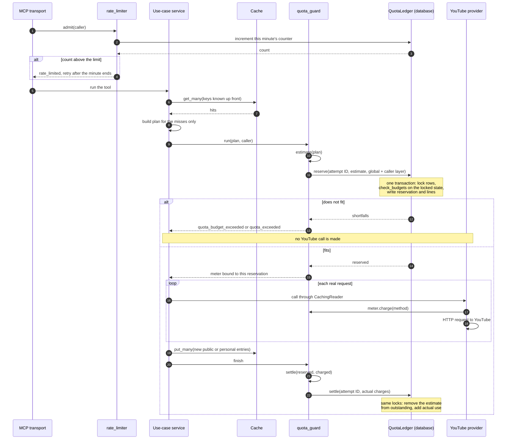

# Quota reservation, rate limiting and caching

- **Status:** Accepted
- **Issue:** #46
- **Decision note:** [`brain/areas/decision-quota-runtime-and-caching.md`](../../brain/areas/decision-quota-runtime-and-caching.md)
- **Requirements:** QM-1 to QM-9, SL-1, SL-2, RL-2, AC-2, AC-10, PF-7, PF-12, PV-1, PV-2

[ADR 0001](../adr/0001-enforce-quota-budget-before-api-calls.md) decided that every workflow is estimated and reserved before any YouTube call, and `youtube_sieve.domain.quota` holds the arithmetic. This document says how that runs: who estimates, how the reservation and settlement fit around the provider calls, how caching lowers the cost, how callers are rate-limited, how Google's `quotaExceeded` is handled, and what the usage resource shows. Implementation is out of scope.

## 1. What this design reuses

Nothing here re-implements logic that already exists. The design only wires it together.

| Existing piece | Where | Used for |
|---|---|---|
| `PlannedCall`, `estimate`, `requests_needed`, `DEFAULT_COST_TABLE` | `youtube_sieve.domain.quota` | The worst-case cost of a plan (step 2 below) |
| `BudgetState`, `check_budgets`, `QuotaDecision`, `Shortfall` | `youtube_sieve.domain.quota` | Deciding whether the estimate fits every budget (step 3) |
| `settle`, `Settlement` | `youtube_sieve.domain.quota` | Releasing the unused part and detecting an undercount (step 5) |
| `quota_day`, `next_reset` | `youtube_sieve.domain.quota` | Which day's budget rows apply, and the reset time in errors and the usage resource |
| BUDGET, RESERVATION, RESERVATION_LINE, RATE_WINDOW, PUBLIC_CACHE, PERSONAL_CACHE | [data-model.md](data-model.md) | Storage of every counter and cache entry |
| Transaction boundary 1, "Quota reservation and settlement" | [data-model.md](data-model.md) | The locking order and the atomic check; repeated here only by reference |
| `QuotaMeter`, the per-method worst-case request counts | [provider-interface.md](provider-interface.md) §5–§7 | Charging each real request against the reservation |
| `quota_budget_exceeded`, `quota_exceeded`, `rate_limited`, `upstream_unavailable` | [errors.md](errors.md) | What callers receive |

## 2. Components

Following [ADR 0003](../adr/0003-layered-architecture.md):

| Component | Layer | Responsibility |
|---|---|---|
| Use-case services (`discovery`, `insights`, `playlists`) | Services | Build the plan for their workflow and run it inside a reservation |
| `quota_guard` | Services | Pick the budgets for the caller, estimate, reserve, hand out a meter, settle, mark exhaustion, answer usage queries |
| `QuotaLedger` port | Ports | `reserve`, `settle`, `mark_exhausted`, `usage`: each one database transaction (section 4) |
| `PublicCache` and `PersonalCache` ports | Ports | `get_many`, `put_many` with a time to live; the personal one is scoped to one account |
| `CachingReader` and `CachingAccountReader` | Services | Wrap a `YouTubeReader` or `AccountReader`: serve hits from cache, pass only misses to the provider |
| `rate_limiter` | Services | `admit(caller)`: one atomic counter increment; called by the transports before any work |
| Storage adapter | Adapters | Implements the ports in PostgreSQL with row locks and conditional updates |

The caching wrappers implement the same protocols as the provider. Use-case services cannot tell whether they talk to the cache or to YouTube (Liskov substitution, ADR 0005).

## 3. Which budgets apply

Every billable workflow is checked against **two** budget rows for the current quota day: the global row, and the caller's own layer.

| Caller | Budget rows checked and reserved | Attributed to (QM-1) |
|---|---|---|
| No credentials (Public tier) | global + public | Public tier |
| Valid MCP credentials, Public or Signed-in operation | global + that account's row | The account |

A signed-in caller who uses a Public tool is charged to their own account, not to the public cap. So a busy public tier cannot block signed-in users, and signed-in users cannot drain the public share.

Default limits, all configurable (QM-3, SRS v0.2):

| Budget | Units per day | `search.list` calls per day |
|---|---|---|
| Global | 10,000 | 100 |
| Public (30% of global) | 3,000 | 30 |
| Each account | 3,000 | 10 |

The configured account unit limit must be at least 2,550, the cost of the largest permitted playlist (QM-3). Startup fails otherwise, so a user could never be unable to create a maximum-size playlist.

The global limit is the real allowance of the Google Cloud project. The public and account limits only stop one caller from using up the shared allowance. Their sum may exceed the global limit, because every reservation also has to fit the global row.

## 4. One workflow, step by step



### Step 1: admission and rate limiting

Before a tool runs, the transport asks `rate_limiter.admit(caller)`. That comes before planning, so a flood of requests costs one database write each and no quota. Section 6 has the details.

### Step 2: plan with the cache, then estimate

The use-case service first asks the cache for everything it can name up front: the seed video, the seed channel, the uploads list, a search with the same normalised parameters. Then it builds a plan of `PlannedCall`s for **only the misses**, using the worst-case request counts in [provider-interface.md](provider-interface.md) §5–§6 and `requests_needed` for batches. `quota_guard` turns the plan into a cost with `estimate`.

Some IDs are only known part-way through. Candidate videos come back from a search, for example. Their lookups are planned at worst case, as if none were cached. Any cache hits during the run simply leave part of the reservation unused, and settlement releases it.

Examples with the default limits:

| Workflow | Plan, nothing cached | Estimate |
|---|---|---|
| FR-1 similar videos | `get_videos` seed (1), `get_channels` seed channel (1), `list_playlist_items` uploads, limit 50 (1), `search_videos` (1 search call), `get_videos` for up to 50 candidates (1; FR-1.3 caps the pool at 50) | 4 units, 1 search call |
| FR-1, seed video and channel cached | uploads (1), search (1 call), candidates (1) | 2 units, 1 search call |
| FR-1, the same search done in the last 6 hours | seed lookups cached, search result cached, candidates' metadata cached | 0: no reservation, no YouTube call |
| FR-5 confirmation of a 20-video draft | `get_videos` re-verify (1), `create_playlist` (50), `add_video` × 20 (1,000) | 1,051 units |

A plan whose estimate is zero is fully served from cache. It skips the ledger entirely, so it still works while a pool is exhausted or the budget is spent (QM-9 rejects only *billable* workflows).

QM-6 is applied while planning: IDs are batched 50 per request, and a workflow may plan at most `max_search_calls_per_workflow` (default 2) `search.list` calls. A plan with more is a programming error, caught in tests.

### Step 3: check and reserve atomically

`QuotaLedger.reserve` runs as **one database transaction**, exactly as transaction boundary 1 of [data-model.md](data-model.md) describes. In short:

1. Lock the global row for the quota day (`quota_day(now)`), then the caller's row, always in that order, so two transactions can never deadlock. Missing rows are created under their unique keys.
2. Build a `BudgetState` for each locked row: `used` = charged + outstanding, `exhausted` = the pool flags.
3. Call the domain's `check_budgets(estimate, states)` on that locked state. The adapter does not re-implement the comparison.
4. If allowed, write the RESERVATION (keyed by a unique attempt ID), one RESERVATION_LINE per row, and add the estimate to each row's outstanding amount, in the same commit. If not, roll back and return the shortfalls.

This is safe with several server instances (SL-2): the check and the increment happen under row locks in the database, and no instance keeps counters in memory. Two instances that reserve at the same moment are serialised by the global row's lock. The second one sees the first one's outstanding amount.

The attempt ID makes the reservation idempotent. If the transport retries after a lost response, the second `reserve` with the same ID returns the first outcome instead of reserving twice.

Rejection is mapped to an error as follows:

- If any shortfall is in a pool that Google marked exhausted (`pool in state.exhausted`), the result is `quota_exceeded` (QM-9).
- Otherwise it is `quota_budget_exceeded`, with `details` built from the first shortfall: the estimate, the remaining amount, which budget (`global`, `public` or `account`) and `next_reset(now)` (QM-2).

### Step 4: run, charging each request

`quota_guard` hands the service a meter that implements the provider's `QuotaMeter` port. It is bound to this reservation and lives only for this workflow, in this process. The provider calls `meter.charge(method)` before every real HTTP request, including retries.

- The meter adds `DEFAULT_COST_TABLE[method]` to its running total.
- If the new total would exceed the reservation in either pool, it raises `QuotaReservationExceeded` and the request is **not sent**. The reservation never overdraws, even when an estimate is wrong.
- Requests served by the caching wrappers never reach the provider, so they are never charged.

The meter is per-request state, which SL-1 permits. Nothing about it outlives the request except what step 5 writes.

### Step 5: settle

When the workflow ends, whether it succeeded or failed, `quota_guard` calls `settle(reserved, charged)` from the domain, then `QuotaLedger.settle(attempt ID, charged)`. That transaction takes the same row locks, removes the estimate from each row's outstanding amount and adds the charged amount. Failed requests count, because Google charges them.

- `Settlement.release` is what becomes available again.
- `Settlement.undercounted` should never be true, because the meter refuses overruns. If it is, the event is logged as a bug with the plan and the attempt ID.

**Crashes.** If an instance dies after reserving, the reservation stays outstanding until its deadline. It is then settled **conservatively**: the whole estimate is charged, because some of it may have been spent and Google will not say. The data model requires the same thing ("never release a possibly spent reservation solely because its lease expired").

**Long writes across midnight.** Playlist confirmation can be resumed. Each resumed run is a new workflow with its own reservation against the day it runs in, so no reservation spans two quota days. This matches the data model's day-boundary rule.

## 5. Caching (QM-5)

### 5.1 What is cached

| Data | Cache | Key | Time to live (default) | Filled by |
|---|---|---|---|---|
| Video metadata (`Video`) | Public | `video:{video_id}` | 24 hours | `get_videos` |
| Channel metadata (`Channel`) | Public | `channel:{channel_id}` | 24 hours | `get_channels`, `find_channel` |
| Handle or username → channel ID | Public | `channel-handle:{handle, lower-case, without @}`, `channel-username:{name}` | 24 hours | `find_channel` |
| Search results (ordered IDs plus `SearchHit`s) | Public | `search:{kind}:{digest of normalised parameters}` | 6 hours | `search_videos`, `search_channels` |
| A public playlist's items (channel uploads) | Public | `playlist-items:{playlist_id}:{limit}` | 6 hours | `YouTubeReader.list_playlist_items` |
| Video categories for a region | Public | `categories:{region_code}` | 24 hours | `list_video_categories` |
| IDs YouTube did not return | Public | `missing:{kind}:{id}` | 1 hour | `Lookup.missing` |
| The user's liked videos, subscriptions, playlists and private playlist items | Personal | Keyed digest of (account, operation, normalised arguments), as in the data model | 1 hour at most | `AccountReader` methods |
| The user's own channel (`get_my_channel`) | Personal | as above | 1 hour at most | `get_my_channel` |

**Normalised parameters.** For search, every `VideoSearch` or `ChannelSearch` field is put into a fixed order. The query is case-folded with whitespace collapsed, and defaults are written out. Then a SHA-256 digest is taken. So two searches that differ only in letter case or spacing share one entry, and the key never contains the query text.

**Not cached:** anything from `PlaylistWriter` (writes); read-backs after a write (FR-5.19 must see YouTube's real state); and every request made under a user token through the public protocol.

**Uploads TTL.** The SRS gives TTLs only for metadata and search results. A channel's uploads list changes as often as a search result, so it uses the search TTL. All TTLs are settings.

**Negative entries** (`missing:`) stop repeated lookups of deleted or private IDs from costing quota. They are kept short, because a private video can become public.

### 5.2 How the public cache stays free of personal data

The acceptance criterion is enforced by construction, not by filtering:

1. **Only the public reader fills the public cache.** `CachingReader` wraps the `YouTubeReader` bound to the System's API key ([provider-interface.md](provider-interface.md) §4), which can only see public data (AC-2). `CachingAccountReader` writes only to the personal cache. There is no code path from a user-token response to the public cache.
2. **Keys contain no caller context.** No account ID, address or token goes into a public key, so an entry cannot reveal who asked for it.
3. **Search text is not stored.** A query might itself be personal ("my school's timetable"), so the key holds only its digest. The entry holds only the public results.
4. **Signed-in reads of public data still share the public cache.** When a signed-in user runs FR-1, the seed and candidates are fetched through the public reader and cached publicly. The user-specific part, excluding their own liked or playlisted videos (FR-1.8), goes through the account reader and the personal cache.

Personal entries are sealed and keyed per account, last at most one hour, are deleted on disconnect, and count toward the 5 MB per-account limit (PF-12). All of that is the data model's job.

### 5.3 How the cache reduces estimates

As step 2 describes, the service looks up every key it can name before planning, and plans only the misses. For IDs found during the run, the estimate is worst case and settlement releases what cache hits saved. Each cached lookup the service can name up front lowers the estimate by that request's cost. A fully cached workflow costs nothing and needs no reservation.

### 5.4 Cache and outages (RL-2)

When YouTube is unavailable, a workflow still answers from entries **within their time to live**. Expired entries are never served, even during an outage; RL-2 permits cached data only "where this is permitted by the time-to-live rules". If anything needed is missing or expired, the result is `upstream_unavailable` with a retry hint.

### 5.5 Bounds

Public entries are removed when they expire, and the public cache has a configurable maximum number of rows. Least recently written entries are evicted first, so it cannot grow without limit as searches vary. Expiry is checked on every read, so cleanup timing never affects correctness.

## 6. Rate limiting (QM-8)

- **Window:** a fixed one-minute window per caller, stored in RATE_WINDOW (data model). `admit` is a single atomic statement: insert or increment the row for (minute, tier, caller key) and return the new count. It is safe with several instances, because the database does the counting (SL-2).
- **Caller key:** the account ID for callers with valid MCP credentials. For public callers, a keyed digest of the client address, so no raw address is stored (PV-1). The address comes from `X-Forwarded-For` only when the request arrived from a configured trusted proxy. Otherwise it is the socket's peer address. A spoofed header from anyone else is ignored.
- **Limit:** `rate_limit_per_minute`, default 60, counting every MCP request: tool calls, list requests and resource reads. Browser pages are counted separately and are not covered by QM-8.
- **Refusal:** if the count exceeds the limit, the request is refused before any work. A tool call gets the tool error `rate_limited` with `retry_after_seconds` until the minute ends. Any other MCP request gets HTTP 429 with `Retry-After` ([errors.md](errors.md) §3.2).
- **Cost:** one write per request, well inside PF-7's 50 ms. Old windows are deleted at the end of each minute; account rows are also deleted on disconnect.

A fixed window can let a caller send up to twice the limit across a minute boundary. That is acceptable here, because quota is protected separately by the budgets: rate limiting only smooths load. A sliding window would need more rows or more arithmetic per request for little gain.

## 7. When Google says the quota is gone (QM-9)

1. The provider raises `QuotaExhausted(pool)` for `quotaExceeded` or `dailyLimitExceeded` ([provider-interface.md](provider-interface.md) §8).
2. `quota_guard` calls `QuotaLedger.mark_exhausted(day, pool)`. One conditional update sets the pool's exhaustion flag on the **global** row for the current quota day. Only that pool is marked: if search calls run out, unit-only workflows keep working.
3. The workflow stops and settles normally: the failed request is charged.
4. From then until `next_reset`, every reservation that needs that pool fails the check in step 3, because `BudgetState.available` returns 0 for an exhausted pool. The caller gets `quota_exceeded` and no request reaches Google. Workflows that need only the other pool, or are fully cached, still work.
5. The flag lives on that day's row, so it disappears by itself when the next day's rows are selected.

Google's `rateLimitExceeded` and `userRateLimitExceeded` are **not** quota exhaustion. The provider retries them a bounded number of times for idempotent reads only, each retry charged to the meter, then raises `Transient` → `upstream_unavailable`.

Upstream detail never reaches the caller: the error object has only the code, the pool and the reset time.

## 8. Usage resource (QM-7)

A Signed-in MCP resource, listed under the Signed-in tier in the AC-1 allow-list. The URI `youtube-sieve://usage` is a proposal for the MCP transport design.

```json
{
  "quota_day": "2026-11-28",
  "resets_at": "2026-11-29T08:00:00Z",
  "account": {
    "units":        {"limit": 3000, "used": 1056, "reserved": 0, "remaining": 1944},
    "search_calls": {"limit": 10,   "used": 3,    "reserved": 1, "remaining": 6}
  },
  "global": {
    "units":        {"limit": 10000, "remaining": 7410, "exhausted": false},
    "search_calls": {"limit": 100,   "remaining": 61,   "exhausted": false}
  }
}
```

- `used` is the charged amount; `reserved` is outstanding reservations. `remaining` is `BudgetState.remaining`, computed by the domain.
- For the global budget, it shows only remaining and exhausted, not other users' or the public tier's usage, so no one learns how others use the service (AC-10).
- Reading it costs no YouTube quota and reserves nothing. It is a plain read of two rows, without locks, so it can be a moment out of date. That is fine for information; enforcement always uses the locked read in step 3.
- Public callers have no usage resource. Their limits appear in `quota_budget_exceeded` errors.

## 9. Settings

All are configuration (PT-1, `AGENTS.md` rule on magic values). Names are indicative; the configuration design fixes the exact environment variable names.

| Setting | Default | Requirement |
|---|---|---|
| `quota_timezone` | `America/Los_Angeles` (`DEFAULT_QUOTA_TIMEZONE`) | QM-1 |
| `quota_global_units`, `quota_global_search_calls` | 10,000; 100 | QM-3 |
| `quota_public_share_percent` | 30 | QM-3 |
| `quota_account_units`, `quota_account_search_calls` | 3,000 (at least 2,550); 10 | QM-3 |
| `quota_cost_table` | `DEFAULT_COST_TABLE` | QM-2 |
| `max_search_calls_per_workflow` | 2 | QM-6 |
| `reservation_lease_seconds` | 120, longer than any workflow's timeout | QM-4 |
| `cache_ttl_metadata_seconds` | 86,400 | QM-5 |
| `cache_ttl_search_seconds`, `cache_ttl_playlist_items_seconds` | 21,600 | QM-5 |
| `cache_ttl_missing_seconds` | 3,600 | QM-5 |
| `cache_ttl_personal_seconds` | 3,600 (maximum allowed: 3,600) | QM-5, PV-2 |
| `public_cache_max_entries` | 100,000 | bounded memory and storage |
| `rate_limit_per_minute` | 60 | QM-8 |
| `trusted_proxies` | empty | QM-8 |

A playlist confirmation can take up to 90 seconds (PF-5), so `reservation_lease_seconds` must exceed that. Startup checks this.

## 10. Tests this design calls for

- **TQ-6:** a workflow whose estimate exceeds a budget is rejected and the fake provider's call log is empty.
- **SL-2, QM-4:** two concurrent reservations that each fit, but not together, against a real test database: exactly one succeeds, and the counters never exceed the limit.
- **Idempotency:** the same attempt ID reserved twice reserves once.
- **Meter:** a plan that undercounts raises `QuotaReservationExceeded`, and the extra request is not sent.
- **Crash:** an unsettled reservation past its lease is charged in full, never released.
- **QM-9:** after `QuotaExhausted(SEARCH_CALLS)`, search workflows get `quota_exceeded` until the reset; unit-only and fully cached workflows still succeed.
- **QM-5:** public-cache keys and values for a signed-in user's request contain no account ID, address, token or query text; personal entries are unreadable by another account and expire within one hour.
- **QM-8:** the 61st request in a minute is refused with the right retry delay; a forwarded address is used only from a trusted proxy.
- **RL-2:** with the provider failing, an unexpired cache entry is served and an expired one is not.
